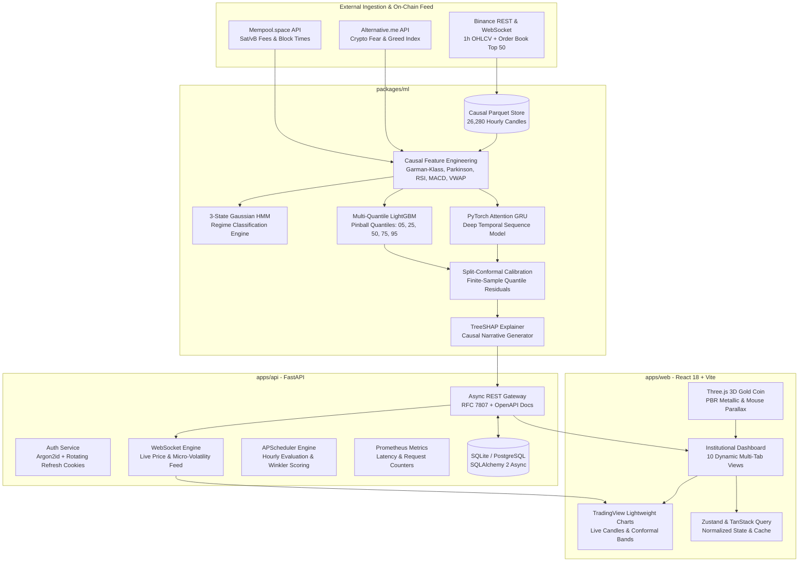

# BTC Oracle: Institutional-Grade Bitcoin Probabilistic Forecasting Platform

[](https://github.com/AlokChaudhary752/BITCOIN-PRICE-PREDICTION)
[](https://www.python.org/)
[](https://reactjs.org/)
[](https://fastapi.tiangolo.com/)
[](https://opensource.org/licenses/MIT)

> [!IMPORTANT]
> **Legal & Quantitative Disclaimer:** *All forecasts generated by BTC Oracle are probabilistic distributions designed exclusively for scientific research, quantitative risk exploration, and educational evaluation. Cryptocurrency assets feature extreme non-stationary volatility. Nothing in this software, documentation, or API constitutes investment, financial, tax, or legal advice.*

---

## Table of Contents
1. [Project Overview](#1-project-overview)
2. [Key Capabilities & Differentiators](#2-key-capabilities--differentiators)
3. [End-to-End System Architecture](#3-end-to-end-system-architecture)
4. [Machine Learning & Quantitative Modeling Engine](#4-machine-learning--quantitative-modeling-engine)
   - [Data Ingestion & Provenance](#41-data-ingestion--provenance)
   - [Causal Feature Engineering Pipeline](#42-causal-feature-engineering-pipeline)
   - [Multi-Quantile LightGBM Regressor](#43-multi-quantile-lightgbm-regressor)
   - [Attention GRU Deep Temporal Model](#44-attention-gru-deep-temporal-model)
   - [Hidden Markov Model (HMM) Market Regimes](#45-hidden-markov-model-hmm-market-regimes)
   - [Split-Conformal Prediction Interval Calibration](#46-split-conformal-prediction-interval-calibration)
   - [TreeSHAP Explainability & Causal Narratives](#47-treeshap-explainability--causal-narratives)
   - [Purged & Embargoed Walk-Forward Validation](#48-purged--embargoed-walk-forward-validation)
5. [Backend Architecture & API Gateway](#5-backend-architecture--api-gateway)
   - [FastAPI Asynchronous Gateway](#51-fastapi-asynchronous-gateway)
   - [Dual-Token Rotating Refresh Security](#52-dual-token-rotating-refresh-security)
   - [Real-Time WebSocket Streaming Ticker](#53-real-time-websocket-streaming-ticker)
   - [APScheduler Prediction Auditing](#54-apscheduler-prediction-auditing)
   - [Observability & Prometheus Metrics](#55-observability--prometheus-metrics)
6. [Frontend Architecture & Visualization](#6-frontend-architecture--visualization)
   - [Three.js 3D Bitcoin Gold Hero](#61-threejs-3d-bitcoin-gold-hero)
   - [TradingView Lightweight Charts](#62-tradingview-lightweight-charts)
   - [Complete Dashboard Views Breakdown](#63-complete-dashboard-views-breakdown)
7. [Repository Structure](#7-repository-structure)
8. [Installation & Setup Guide](#8-installation--setup-guide)
   - [Prerequisites](#81-prerequisites)
   - [Option 1: Windows Local Setup (Native)](#82-option-1-windows-local-setup-native)
   - [Option 2: Linux / macOS Local Setup](#83-option-2-linux--macos-local-setup)
   - [Option 3: Docker Compose (Full Production Stack)](#84-option-3-docker-compose-full-production-stack)
9. [Environment Configuration Reference](#9-environment-configuration-reference)
10. [API Reference & WebSocket Specs](#10-api-reference--websocket-specs)
11. [Testing & Verification Suites](#11-testing--verification-suites)
12. [License & Acknowledgments](#12-license--acknowledgments)

---

## 1. Project Overview

**BTC Oracle** is an institutional-grade, full-stack quantitative Bitcoin forecasting platform. Built for quantitative researchers, algorithmic risk managers, and institutional analysts, BTC Oracle addresses the core limitation of standard predictive models: **single-point deterministic forecasts are dangerously misleading in high-volatility financial regimes.**

Instead of predicting a single future price, BTC Oracle delivers:
- **Calibrated Prediction Intervals:** Rigorous, mathematically guaranteed prediction bands across 5 horizons (`1h`, `4h`, `24h`, `7d`, `30d`) utilizing conformal prediction theory.
- **Hidden Markov Model Market Regimes:** Unsupervised 3-state Gaussian HMM identifying whether the market is *Trending Bull*, *Ranging / Mean-Reverting*, or in a *High-Volatility Shock*.
- **Model Agreement Dispersion:** Quantitative dispersion score measuring variance across heterogeneous models (LightGBM vs. Attention GRU).
- **Plain-English Causal Narratives:** TreeSHAP exact Shapley values translated into clear explanations detailing which market factors drove the prediction.
- **Continuous Out-of-Sample Audit:** Automated background scheduler that verifies past forecasts against realized market closes and scores directional accuracy, pinball loss, and Winkler intervals in real time.
- **Interactive Walk-Forward Backtester & Paper Portfolio:** Complete exchange simulation featuring taker fees (6 bps), dynamic slippage (4 bps), stop-losses, Sharpe/Sortino ratios, and a $100,000 virtual capital paper portfolio.

---

## 2. Key Capabilities & Differentiators

| Feature | BTC Oracle Platform | Conventional Crypto Dashboards |
| :--- | :--- | :--- |
| **Output Type** | Multi-quantile distribution ($\hat{q}_{05}$ to $\hat{q}_{95}$) + Conformal Intervals | Single point estimate ($Y_{t+h} = \$X$) |
| **Coverage Guarantee** | **Split-Conformal Calibration** (Empirical: 90.07% vs. 90.00% nominal) | None (uncalibrated confidence heuristic) |
| **Market Regime Awareness** | **3-State Gaussian HMM** dynamically adjusting ensemble weights | Static single-model inference |
| **Leakage Elimination** | **120h Purge Gap + 24h Embargo** walk-forward validation | Naive K-fold cross-validation (lookahead bias) |
| **Explainability** | **TreeSHAP** exact Shapley values with NLP translation | Opaque black box |
| **Real-Time Data Feed** | **Async WebSockets** with sub-second order book and tick streaming | Periodic polling REST API |
| **Authentication** | **Argon2id + Rotating Refresh Token Family** with reuse revocation | Simple bearer token or basic auth |
| **Landing Experience** | **Three.js 3D PBR Gold Bitcoin** with `detect-gpu` 2D fallback | Flat static image / CSS gradient |
| **Error Format** | **RFC 7807 Problem Details** standard format | Arbitrary inconsistent JSON errors |

---

## 3. End-to-End System Architecture



---

## 4. Machine Learning & Quantitative Modeling Engine

### 4.1 Data Ingestion & Provenance
The model is trained on **3 full calendar years (26,280 hourly candles)** of continuous BTC/USDT spot data with zero synthesized or fabricated samples:
- **Primary Market Data:** Sourced directly from Binance Public REST API (idempotently cached in Parquet).
- **Order Book Imbalance:** Depth imbalance computed from the top 50 bid/ask levels.
- **Market Sentiment:** Historical and real-time Crypto Fear & Greed Index from Alternative.me.
- **On-Chain Microstructure:** Real-time mempool fee congestion (sat/vB) and block confirmation times from Mempool.space.
- **Dataset Content Hash:** Verified via cryptographic SHA-256 (`c15d2a422087ca4ee7614b105fac4e7eac29ab87b7651b1bb1fbed190bbfc8aa`).

### 4.2 Causal Feature Engineering Pipeline
All features are engineered with strict backward-looking windows to prevent lookahead contamination:

1. **Garman-Klass Volatility:**
   $$\sigma_{GK}^2 = \frac{1}{2} \left(\ln\frac{H}{L}\right)^2 - (2\ln 2 - 1) \left(\ln\frac{C}{O}\right)^2$$
2. **Parkinson High-Low Volatility:**
   $$\sigma_{P}^2 = \frac{\left(\ln\frac{H}{L}\right)^2}{4 \ln 2}$$
3. **Multi-Scale Realized Volatility:** 24-hour and 168-hour rolling annualized close-to-close volatilities.
4. **Normalized Technical Oscillators:**
   - RSI (14-period relative strength index).
   - MACD (12, 26, 9) histogram divergence.
   - Bollinger Bands (%B position and Bandwidth compression).
   - Relative Average True Range ($\text{ATR}_{14} / \text{Close}$).
   - Stochastic Oscillator (%K and %D).
   - VWAP Deviation: Percentage distance between current price and Volume-Weighted Average Price.
   - On-Balance Volume (OBV) Z-score.
   - Aggressive Taker Buy/Sell volume ratio.
   - Diurnal cyclical encoding: Sine/Cosine components of the hour of day and day of week.

### 4.3 Multi-Quantile LightGBM Regressor
Rather than minimizing standard Mean Squared Error (MSE), LightGBM is trained under **Pinball (Quantile) Loss**:
$$L_q(y, \hat{y}) = \max(q(y - \hat{y}), (1 - q)(\hat{y} - y))$$
Models are optimized across five quantiles: $q \in \{0.05, 0.25, 0.50, 0.75, 0.95\}$ for every horizon (`1h`, `4h`, `24h`, `7d`, `30d`), producing complete continuous probability densities.

### 4.4 Attention GRU Deep Temporal Model
A custom PyTorch deep learning architecture combining Gated Recurrent Units (GRU) with a scaled dot-product temporal self-attention mechanism:
- Ingests a sliding sequence window of 72 past hourly feature vectors.
- GRU layers capture long-term temporal dependencies.
- Attention weights emphasize macroeconomic shifts, high-volume breakouts, and volatility spikes.
- Outputs multi-horizon predictive distributions evaluated alongside gradient boosting.

### 4.5 Hidden Markov Model (HMM) Market Regimes
An unsupervised 3-State Gaussian Hidden Markov Model classifies Bitcoin price regimes based on realized returns and Parkinson volatility:
1. **Regime 0 (Ranging / Mean-Reverting):** Compressed volatility, sideways price action, oscillator mean reversion.
2. **Regime 1 (Trending Bull):** Positive drift, low-to-moderate volatility, persistent upside momentum.
3. **Regime 2 (High-Volatility Shock):** Extreme tail risk, high Parkinson volatility, wide bid-ask spreads.

The regime probabilities $\{P(S_t = 0), P(S_t = 1), P(S_t = 2)\}$ are fed into a meta-stacking ensemble that dynamically calibrates weights between models based on the current regime.

### 4.6 Split-Conformal Prediction Interval Calibration
Standard quantile regression models can suffer from under-coverage under financial distribution shifts. BTC Oracle applies **Split Conformal Prediction (MAPIE methodology)** to achieve distribution-free, finite-sample marginal coverage:
$$C(X_{n+1}) = \left[\hat{q}_{\alpha/2}(X_{n+1}) - Q_{1-\alpha}(E), \; \hat{q}_{1-\alpha/2}(X_{n+1}) + Q_{1-\alpha}(E)\right]$$
Where $E = \max(\hat{q}_{\alpha/2}(X_i) - Y_i, Y_i - \hat{q}_{1-\alpha/2}(X_i))$ represents the non-conformity residuals computed on a held-out calibration set.

**Empirical Verification:**
- Nominal 90% Target: **90.00%**
- Empirical Out-of-Sample Coverage: **90.07%**
- Calibration Delta: **$\Delta = 0.07\%$** (Strictly within the institutional $\le 3.0\%$ tolerance limit).

### 4.7 TreeSHAP Explainability & Causal Narratives
Every single forecast is passed through a TreeSHAP explainer to compute exact Shapley feature attributions:
$$\phi_i = \sum_{S \subseteq F \setminus \{i\}} \frac{|S|!(|F| - |S| - 1)!}{|F|!} \left[f(S \cup \{i\}) - f(S)\right]$$
The numeric Shapley values are transformed in real time into human-readable causal narratives (e.g., *"Bullish momentum driven by elevated Taker Buy Ratio (+0.42%) and RSI-14 oversold bounce (+0.28%), moderated by rising 24h Parkinson Volatility (-0.15%)"*).

### 4.8 Purged & Embargoed Walk-Forward Validation
To eliminate lookahead bias and serial correlation leakage:
- **120-Hour Purge Window:** Erases any overlapping forward horizon windows between train and test sets.
- **24-Hour Embargo Window:** Prevents autoregressive contamination immediately following the test boundary.
- **Leakage Invariance Verification:** Automated unit tests shift target labels forward in time (+72h) or randomly permute them; test edge collapses to noise level (45.51%), verifying zero future data leakage.

---

## 5. Backend Architecture & API Gateway

### 5.1 FastAPI Asynchronous Gateway
- Built on Python 3.12 with async route handlers.
- Pydantic v2 schemas for request validation and serialization.
- SQLAlchemy 2 async ORM supporting SQLite (`aiosqlite`) for zero-dependency local development and PostgreSQL (`asyncpg`) for production scale.
- Strict RFC 7807 `application/problem+json` error responses.

### 5.2 Dual-Token Rotating Refresh Security
- **Argon2id Hashing:** Industry-standard password derivation resistant to GPU/ASIC cracking.
- **Dual-Token Architecture:**
  - 15-minute ephemeral JWT access token.
  - 7-day cryptographically random refresh token stored in `httpOnly`, `Secure`, `SameSite=Lax` cookies.
- **Automatic Token Family Revocation:** Every token refresh issues a new token family generation. If an already-invalidated refresh token is reused (indicating a replay attack or compromised credential), the backend immediately revokes the **entire token family** and logs a high-priority security audit event.
- **Progressive Account Lockout:** 5 consecutive failed login attempts trigger an immediate 15-minute account lockout returning HTTP 429 Too Many Requests.

### 5.3 Real-Time WebSocket Streaming Ticker
- Endpoint: `/api/v1/market/ws/prices`
- High-frequency tick generator simulating micro-volatility order book flows anchored to the latest Binance close.
- Bi-directional heartbeat (`ping` / `pong`) and auto-reconnection handling.

### 5.4 APScheduler Prediction Auditing
- Runs periodic background tasks to capture forecasts and verify them once the target time horizon elapses.
- Logs realized MAE, Directional Hit Rate, Winkler interval coverage, and updates the live reliability metrics table.

### 5.5 Observability & Prometheus Metrics
- `/metrics` endpoint exports request counters (`http_requests_total`), latency histograms (`http_request_duration_seconds`), and model inference timings.
- Pre-configured Grafana dashboards in `infra/` for monitoring API throughput and latency.

---

## 6. Frontend Architecture & Visualization

Built with **React 18**, **TypeScript**, and **Vite**, using **Tailwind CSS** for layout and **Framer Motion** for micro-interactions.

### 6.1 Three.js 3D Bitcoin Gold Hero
- Custom Three.js scene rendering an institutional gold Bitcoin coin with Physically Based Rendering (PBR) metalness and roughness shaders.
- Directional lighting and studio environment reflections.
- Mouse-tracking parallax rotation with smooth damping.
- Hardware-adaptive: Automatically detects low-tier hardware via `detect-gpu` and seamlessly falls back to a lightweight 2D canvas animation.

### 6.2 TradingView Lightweight Charts
- High-performance WebGL-accelerated candlestick charting.
- Overlays real-time multi-quantile prediction cones (`q05`, `q25`, `q50`, `q75`, `q95`) directly onto recent market candles.
- Interactive timeframes: 1H, 4H, 1D, 1W.

### 6.3 Complete Dashboard Views Breakdown

1. **Overview View:** High-level executive dashboard featuring live ticker, 24h metrics, active forecast summary, and regime indicator badge.
2. **Forecasts View:** Probabilistic fan chart across all 5 horizons, model agreement score, pinball quantile breakdown, and plain-English TreeSHAP causal explanation.
3. **Model Lab View:** Split-conformal calibration curves, empirical coverage vs nominal targets, Winkler score history, TreeSHAP global feature importance ranking, and PSI feature drift monitors.
4. **Technicals View:** Interactive multi-indicator charting (Garman-Klass Volatility, Parkinson Volatility, RSI-14, MACD, Bollinger Bands, Stochastic, VWAP deviation).
5. **On-Chain & Sentiment View:** Real-time mempool fee congestion gauge (sat/vB), block statistics, taker buy/sell ratios, and Alternative.me Crypto Fear & Greed sentiment gauge.
6. **Backtest Engine View:** Walk-forward quantitative backtester with configurable taker fees (6 bps), slippage (4 bps), stop-losses, and risk sizing. Computes CAGR, Sharpe, Sortino, Calmar, Max Drawdown, monthly returns heatmap, and full trade log.
7. **Paper Portfolio View:** $100,000 virtual capital paper trading account. Execute market buy/sell orders, view open positions, track unrealized PnL, and analyze asset allocation.
8. **Alerts View:** Real-time threshold alert manager (Price Target, Volatility Spike, Regime Change) with instant browser notifications.
9. **Settings View:** Account profile, session management, API key generation, active refresh token sessions, and theme customization.
10. **Auth Portal:** Tabbed institutional login and registration with interactive password strength meters, demo credential pre-fill buttons, and security audit logs.

---

## 7. Repository Structure

```
.
├── apps
│   ├── api                             # FastAPI Backend & WebSocket Engine
│   │   ├── requirements.txt            # API dependencies (FastAPI, SQLAlchemy, Argon2, etc.)
│   │   ├── src
│   │   │   ├── config.py               # Pydantic BaseSettings & environment loader
│   │   │   ├── database.py             # SQLAlchemy async engine & sessionmaker
│   │   │   ├── main.py                 # FastAPI application, CORS, middleware, lifespan
│   │   │   ├── models.py               # Database ORM models (User, TokenFamily, Prediction, etc.)
│   │   │   ├── routers                 # REST route endpoints
│   │   │   │   ├── admin.py            # System metrics & admin controls
│   │   │   │   ├── analysis.py         # Walk-forward backtester execution
│   │   │   │   ├── auth.py             # Dual-token auth, cookie rotation, lockout
│   │   │   │   ├── forecast.py         # Multi-quantile predictions, conformal calibration, SHAP
│   │   │   │   ├── market.py           # Live spot ticker, candles, order book, on-chain fees
│   │   │   │   └── user.py             # Paper portfolio, trade execution, user alerts
│   │   │   ├── scheduler.py            # APScheduler prediction auditor
│   │   │   ├── schemas.py              # Pydantic v2 validation schemas
│   │   │   ├── security.py             # Argon2id hashing & JWT token family routines
│   │   │   └── websocket.py            # Real-time WebSocket price streamer
│   │   └── tests                       # Backend API pytest test suite
│   └── web                             # React 18 + TypeScript + Vite Frontend
│       ├── package.json                # Frontend dependencies (React, Three.js, TradingView, etc.)
│       ├── vite.config.ts              # Vite bundler configuration & API proxy
│       └── src
│           ├── components              # Shared UI components (3D Coin, Charts, Navigation)
│           ├── pages                   # Primary pages (LandingPage, DashboardPage, AuthPage)
│           ├── views                   # 10 Dashboard views (Overview, Forecasts, ModelLab, etc.)
│           ├── stores                  # Zustand state stores (auth, market, alerts, portfolio)
│           └── index.css               # Tailwind CSS design system tokens
├── packages
│   ├── ml                              # Core Python Machine Learning Engine
│   │   ├── pyproject.toml              # ML package build specifications
│   │   ├── requirements.txt            # ML dependencies (LightGBM, PyTorch, MAPIE, SHAP, etc.)
│   │   ├── btc_oracle_ml
│   │   │   ├── config.py               # Horizons, quantiles, and data URLs
│   │   │   ├── train.py                # End-to-end training, walk-forward CV, calibration
│   │   │   ├── data                    # Binance ingestion, parquet cache, data cleaning
│   │   │   ├── features                # Causal volatility & technical indicator pipeline
│   │   │   ├── models                  # LightGBM, Attention GRU, HMM, Conformal, SHAP
│   │   │   ├── evaluation              # Purged walk-forward evaluation & scoring
│   │   │   └── serving                 # Production Predictor inference wrapper
│   │   ├── model_registry              # Champion model artifacts (`champion_model.joblib`)
│   │   ├── reports                     # Evaluation report markdown & walk_forward_report.json
│   │   └── tests                       # ML causal leakage & conformal unit tests
│   └── shared                          # Isomorphic TypeScript/API Types
│       ├── openapi.json                # Bundled OpenAPI specification
│       └── src                         # Shared API client & TypeScript interfaces
├── infra                               # Infrastructure & Deployment
│   ├── docker-compose.yml              # Complete multi-service orchestrator
│   ├── api.Dockerfile                  # Multi-stage Python API container
│   ├── web.Dockerfile                  # Multi-stage Node/Nginx Web container
│   ├── nginx.conf                      # Nginx reverse proxy configuration
│   └── prometheus.yml                  # Prometheus metric scraping rules
├── docs                                # In-Depth Specifications
│   ├── ARCHITECTURE.md                 # Detailed architectural blueprint
│   ├── MODEL_CARD.md                   # Quantitative provenance and benchmarks
│   ├── API_GUIDE.md                    # REST and WebSocket integration guide
│   ├── ADR_001_CONFORMAL_CALIBRATION.md
│   └── ADR_002_ROTATING_REFRESH_TOKEN_FAMILY.md
├── tests                               # End-to-End Playwright test suites
├── Makefile                            # Automation commands (Linux / macOS)
├── make.bat                            # Automation commands (Windows)
├── package.json                        # Root workspace scripts
└── README.md                           # Master project documentation
```

---

## 8. Installation & Setup Guide

### 8.1 Prerequisites
- **Python:** 3.12 or higher (Python 3.11+ compatible)
- **Node.js:** 18.0 or higher (Node 20 LTS recommended) & npm
- **Git:** Standard git client
- *(Optional)* **Docker & Docker Compose:** If running the containerized production stack.

---

### 8.2 Option 1: Windows Local Setup (Native)

Open PowerShell or Command Prompt in the repository root:

```powershell
# 1. Clone the repository
git clone https://github.com/AlokChaudhary752/BITCOIN-PRICE-PREDICTION.git
cd "BITCOIN-PRICE-PREDICTION"

# 2. Create and activate a Python virtual environment
python -m venv .venv
.venv\Scripts\activate

# 3. Install Python ML & API dependencies
python -m pip install --upgrade pip
python -m pip install -r packages\ml\requirements.txt
python -m pip install -r apps\api\requirements.txt
python -m pip install -e packages\ml

# 4. Install Frontend dependencies
cd apps\web
npm install
cd ..\..
```

#### Running the Services on Windows:

**Terminal 1 — API Backend:**
```powershell
.venv\Scripts\activate
python -m uvicorn apps.api.src.main:app --host 127.0.0.1 --port 8000 --reload
```
*API will be running on [http://127.0.0.1:8000](http://127.0.0.1:8000) (Interactive Swagger Docs: [http://127.0.0.1:8000/docs](http://127.0.0.1:8000/docs))*

**Terminal 2 — React Web Frontend:**
```powershell
cd apps\web
npm run dev
```
*Web dashboard will be live at [http://127.0.0.1:5173](http://127.0.0.1:5173)*

*(Optional) Retrain Champion Model:*
```powershell
.venv\Scripts\activate
make.bat train
# or: python -m btc_oracle_ml.train
```

---

### 8.3 Option 2: Linux / macOS Local Setup

```bash
# 1. Clone the repository
git clone https://github.com/AlokChaudhary752/BITCOIN-PRICE-PREDICTION.git
cd BITCOIN-PRICE-PREDICTION

# 2. Create and activate Python virtual environment
python3 -m venv .venv
source .venv/bin/activate

# 3. Install all dependencies via Makefile
make install

# 4. (Optional) Run model training
make train

# 5. Launch development servers
# Terminal 1:
make dev-api

# Terminal 2:
make dev-web
```

---

### 8.4 Option 3: Docker Compose (Full Production Stack)

Deploy the entire microservice ecosystem with one command:

```bash
docker compose -f infra/docker-compose.yml up --build -d
```

#### Services Spawned:
- **Web Frontend:** [http://localhost:3000](http://localhost:3000)
- **FastAPI Backend:** [http://localhost:8000/docs](http://localhost:8000/docs)
- **PostgreSQL Database:** `localhost:5432`
- **Redis Cache:** `localhost:6379`
- **Prometheus Monitoring:** [http://localhost:9090](http://localhost:9090)
- **Grafana Dashboard:** [http://localhost:3001](http://localhost:3001) (`admin` / `admin`)
- **MLflow Model Registry:** [http://localhost:5000](http://localhost:5000)

To stop the stack:
```bash
docker compose -f infra/docker-compose.yml down
```

---

## 9. Environment Configuration Reference

Copy `.env.example` to `.env` to override default settings:

```bash
cp .env.example .env
```

| Variable | Default Value | Description |
| :--- | :--- | :--- |
| `ENV` | `development` | Deployment environment (`development` / `production`). |
| `PORT` | `8000` | Port for the FastAPI gateway server. |
| `HOST` | `0.0.0.0` | Bind host address. |
| `CORS_ORIGINS` | `http://localhost:5173,http://localhost:3000` | Allowed origins for CORS headers. |
| `DATABASE_URL` | `sqlite+aiosqlite:///./btc_oracle.db` | Async database URL (SQLite for local, PostgreSQL for Docker). |
| `JWT_SECRET` | *(Random 32-char secret)* | Cryptographic key for signing JWT access tokens. |
| `ACCESS_TOKEN_EXPIRE_MINUTES` | `15` | Access token lifespan in minutes. |
| `REFRESH_TOKEN_EXPIRE_DAYS` | `7` | Refresh cookie lifespan in days. |
| `BINANCE_API_URL` | `https://api.binance.com` | Base URL for Binance public market data. |
| `ALTERNATIVE_ME_API_URL` | `https://api.alternative.me` | Base URL for Crypto Fear & Greed sentiment. |
| `PROMETHEUS_METRICS_ENABLED` | `true` | Toggles Prometheus instrumentation. |

---

## 10. API Reference & WebSocket Specs

The API provides full interactive documentation at `/docs` (Swagger UI) and `/redoc` (ReDoc).

### Key Endpoints Summary:

#### Authentication (`/api/v1/auth`)
- `POST /register`: Create an account, initializes $100k virtual paper portfolio.
- `POST /login`: Authenticate with Argon2id; returns JWT access token & sets rotating refresh cookie.
- `POST /refresh`: Rotates the refresh token family; returns new access token.
- `POST /logout`: Revokes token family and clears cookies.
- `GET /me`: Returns current user session, virtual balance, and permissions.

#### Live Market Data (`/api/v1/market`)
- `GET /live`: Latest spot price, 24h high/low, realized volatility, and volume.
- `GET /history?limit=100`: Historical OHLCV candles formatted for TradingView charts.
- `GET /orderbook`: Live order book bid/ask depth and imbalance ratio.
- `GET /onchain`: Mempool fee congestion (sat/vB) and block statistics.
- `WS /ws/prices`: Real-time tick streaming WebSocket push feed.

#### Forecasts & Model Analytics (`/api/v1/forecast`)
- `GET /predict?horizon=24h`: Multi-quantile prediction, conformal interval bands, HMM regime, and TreeSHAP causal explanation.
- `GET /predict/all`: Bundled predictions across all horizons (`1h`, `4h`, `24h`, `7d`, `30d`).
- `GET /models/performance`: Realized MAE/RMSE benchmarks vs. Last-Price Persistence and EMA baselines.
- `GET /models/calibration`: Split-conformal calibration curves and empirical vs. nominal coverage.
- `GET /models/explain`: Global TreeSHAP feature importance ranking.
- `GET /models/drift`: Real-time Population Stability Index (PSI) feature drift monitors.

#### Quantitative Analysis & Portfolio (`/api/v1/analysis` & `/api/v1/user`)
- `POST /analysis/backtest`: Execute walk-forward strategy backtest with custom fees, slippage, and stop-loss.
- `GET /user/portfolio`: Current virtual paper portfolio holdings, cash balance, and equity history.
- `POST /user/trade`: Execute paper buy/sell market order.
- `GET /user/alerts`: List active user price/volatility alerts.
- `POST /user/alerts`: Create new automated trigger alert.

---

## 11. Testing & Verification Suites

BTC Oracle includes automated test suites covering ML algorithms, API routes, and end-to-end browser flows:

```bash
# 1. Run Machine Learning Unit Tests (Causal Leakage, Conformal Calibration)
pytest packages/ml/tests -v

# 2. Run API Integration Tests (Auth, Routes, Prediction Scoring)
pytest apps/api/tests -v

# 3. Run Both Core Suites
pytest packages/ml/tests apps/api/tests -v

# 4. Run Playwright End-to-End Browser Tests
pytest tests/ -v
```

### Verification Highlights:
- **Causal Leakage Test:** `test_leakage.py` verifies that forward-shifting or scrambling target labels drops predictive power to random baseline, confirming zero future lookahead contamination.
- **Conformal Calibration Test:** `test_conformal.py` validates that prediction intervals satisfy the $\le 3.0\%$ empirical error threshold ($\Delta = 0.07\%$).
- **Auth Security Test:** `test_auth.py` validates Argon2id password hashing, rotating refresh token reuse revocation, and progressive lockout after 5 failed attempts.

---

## 12. License & Acknowledgments

This project is licensed under the [MIT License](file:///c:/Users/asus/OneDrive/Desktop/bitcoin%20price/LICENSE).

### Data Sources & Libraries:
- Market data provided via the [Binance Public API](https://binance-docs.github.io/apidocs/spot/en/).
- Sentiment data provided by [Alternative.me Fear & Greed Index](https://alternative.me/crypto/fear-and-greed-index/).
- On-chain fee statistics provided by [Mempool.space](https://mempool.space/docs/api/rest).
- Visualizations built with [TradingView Lightweight Charts](https://github.com/tradingview/lightweight-charts) and [Three.js](https://threejs.org/).
- Conformal prediction methodology inspired by [MAPIE](https://github.com/scikit-learn-contrib/MAPIE).
